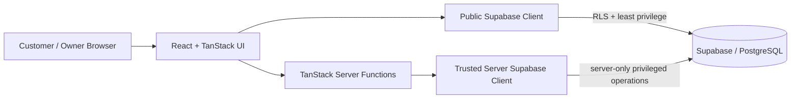

# SalonFlow AZ — Public Portfolio Case Study

**Mobile-first booking and mini-CRM for beauty salons and laser centers in Azerbaijan.**

This repository is a **public portfolio case study** for SalonFlow AZ. The production source repository remains private so that internal implementation details, environment configuration, and commercial product IP are not exposed publicly.

## Recruiter quick scan

- **Product:** booking + mini-CRM SaaS for beauty businesses
- **Primary stack:** React 19, TypeScript, TanStack Router / TanStack Start, Vite 8, Supabase, Tailwind CSS 4, Nitro
- **Backend pattern:** server functions + Supabase/PostgreSQL
- **Validation:** Zod and server-side input validation
- **Security:** server-only privileged credentials, RLS / least-privilege public access, sensitive RPC restrictions
- **Testing:** auth/onboarding, owner panel, booking, recovery, waitlist, notifications, reminder workers, marketplace, distribution, revenue and content flows
- **Development style:** AI-assisted product development with extensive verification, iteration and testing

## Product problem

Small beauty salons and laser centers often manage appointments through fragmented channels such as phone calls, direct messages and manual notes. SalonFlow AZ explores a localized, mobile-first workflow where a customer can discover services and book a time while the business manages appointments and customer context from one owner-facing product.

## Customer-side scope

- Mobile-first salon landing experience
- Services, prices and durations
- Specialist selection
- Available date/time selection
- Booking creation and confirmation
- Waitlist flow for full schedules
- Azerbaijani-first product experience

## Business / owner-side scope

- Secure owner login and onboarding
- Booking dashboard and status management
- Customer history and notes
- Services and specialist management
- Working-hours configuration
- Reminder / notification workflows
- Basic product and operational analytics

## Architecture

Public catalog-style reads use the publishable Supabase client and database authorization controls. Sensitive booking and privileged operations are routed through trusted server-side functions; the `SUPABASE_SERVICE_ROLE_KEY` is never intended for browser bundles or public client code.

For more detail, see [docs/ARCHITECTURE.md](docs/ARCHITECTURE.md).

## Engineering and security decisions

### Server/client trust boundary

The application separates browser-safe configuration from server-only credentials. Privileged operations use trusted server-side execution instead of exposing administrative database capabilities to the client.

### Least-privilege database access

Public-facing reads are designed around Row Level Security and restricted grants. Sensitive booking RPCs are intentionally not exposed as general `anon` / `authenticated` client operations.

### Validation and failure handling

Input validation and server-side checks are used around booking and workflow boundaries. The project also includes controlled handling for recovery, reminders, notifications and waitlist behavior.

### Product readiness mindset

The work is not limited to page implementation. The repository includes verification scripts and tests across product flows, plus explicit separation between features that are implemented and features that should not be marketed as live before their provider / production verification is complete.

## Testing / verification surface

The private source project contains test coverage for areas including:

- authentication and onboarding
- owner panel behavior
- public and manual booking flows
- tenant-public booking boundaries
- customer / session recovery
- waitlist controlled E2E behavior
- owner booking notifications
- web push and notification fan-out
- reminder worker behavior
- marketplace / service discovery
- managed growth and distribution flows
- revenue economic events
- content capture / content studio routes

The project also uses standard verification commands for **type checking, build, linting and automated tests**.

## Technology

| Area | Technology |
|---|---|
| Language | TypeScript |
| Front end | React 19 |
| Routing / full-stack framework | TanStack Router + TanStack Start |
| Build | Vite 8 |
| Backend / database | Supabase + PostgreSQL |
| UI | Tailwind CSS 4 + Radix UI components |
| Validation | Zod |
| Data / UI utilities | TanStack Query, React Hook Form, date-fns, Recharts |
| Runtime | Nitro |

## My role and AI-assisted workflow

I built and iterated on SalonFlow AZ as an **AI-assisted product builder**. I use AI tools extensively for implementation support, debugging, refactoring, test generation/review and product iteration.

I do **not** present AI-assisted work as unaided manual coding. The value I aim to demonstrate is the ability to:

- translate a product problem into a working system;
- reason about architecture and trust boundaries;
- integrate front-end, server and database layers;
- review generated implementation critically;
- test and verify behavior instead of accepting generated code blindly;
- iterate from product requirements and failure cases to a more reliable result.

## Why the production source is private

The production repository contains the full implementation history and internal product details. It remains private to avoid exposing unnecessary commercial IP and operational internals.

This public repository is intentionally focused on **architecture, product scope, engineering decisions and verifiable project evidence**. Selected source or a guided technical walkthrough can be provided when appropriate during a hiring process.

## Related portfolio work

My GitHub profile also contains projects around Python/FastAPI integrations, MCP-style tooling, browser automation/auditing and video workflow automation.

- GitHub: https://github.com/amfreeone1
- LinkedIn: https://www.linkedin.com/in/hafiz-shafiyev/

## Contact

**Hafis Şəfiyev**  
Baku, Azerbaijan  
Email: hsefiyev520@gmail.com

---

> Portfolio note: this repository is a case study, not the production source tree.
