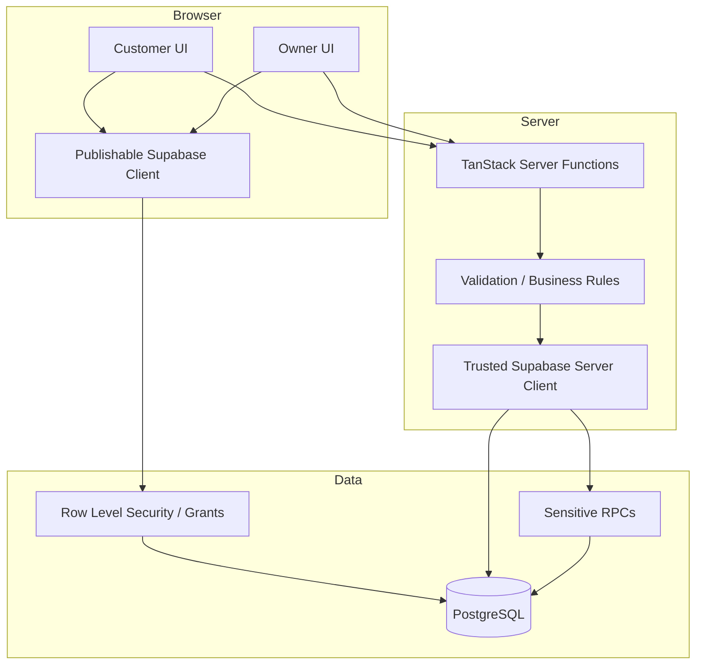

# SalonFlow AZ — Architecture Notes

This document summarizes the architecture at a level suitable for a public portfolio. It intentionally excludes secrets, production identifiers, private database details and proprietary source code.

## System shape

SalonFlow AZ is a mobile-first full-stack web application built around a React/TanStack front end and a Supabase/PostgreSQL backend.

## Trust boundaries

### Browser-safe boundary

The browser receives only configuration intended for public client use. Public catalog-style access goes through the publishable Supabase client and database authorization controls.

### Trusted server boundary

Privileged operations are routed through server functions. The Supabase service-role credential is treated as server-only and is not intended to appear in client bundles, browser-visible environment variables, screenshots or logs.

### Database boundary

Publicly reachable data operations are constrained through Row Level Security and reduced grants. Sensitive booking RPCs are intentionally separated from normal browser-side execution.

## Booking flow

At a high level, a customer flow follows:

1. open salon landing experience;
2. select service;
3. select specialist;
4. choose an available date/time;
5. submit booking data;
6. server validates state and trusted operation requirements;
7. booking is created / confirmed;
8. owner-side workflows can manage the resulting appointment.

When availability is exhausted, the product also includes a controlled waitlist path.

## Owner workflow

The owner-facing product includes operational flows for:

- authentication / onboarding;
- appointments and status changes;
- customer history and notes;
- services and specialists;
- working hours;
- reminder / notification state;
- operational statistics.

## Verification approach

The private production repository includes automated test coverage across multiple product areas rather than relying only on UI smoke tests. The project uses type checking, build verification, linting and targeted automated test suites.

Representative tested areas include authentication, owner flows, booking, recovery, waitlist, notifications, reminder workers, marketplace/discovery, growth/distribution, revenue events and content workflows.

## AI-assisted development

AI tools were used extensively as part of implementation, debugging, review and iteration. Architecture and product claims in this portfolio are deliberately limited to behavior and boundaries that are supported by the underlying project artifacts.
